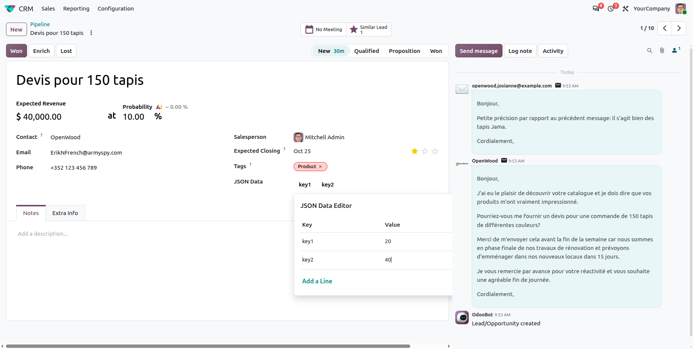

# Advanced JSON Widget for Odoo 20

[](https://www.odoo.com)
[](https://www.gnu.org/licenses/lgpl-3.0.html)

An interactive and intuitive widget for managing JSON fields in Odoo 20, built using the modern OWL JavaScript framework.

## Overview

The Advanced JSON Widget is an Odoo module designed to simplify the management of JSON fields by providing an intuitive, interactive interface using OWL, allowing users to view, edit, and organize key-value data seamlessly within the Odoo backend.

## Features

- 🧩 **Interactive JSON Editor**: Easily add, edit, and delete key-value pairs with a user-friendly UI.
- ⚙️ **Seamless Odoo Integration**: Works effortlessly with Odoo 20 models using JSON fields.
- 🚀 **Modern OWL Framework**: Built with Odoo's OWL JavaScript framework for reactive and responsive behavior.
- 💾 **Structured Data Management**: Ensures clean and consistent JSON data storage within your records.

## Screenshots

Here are some glimpses of JSON Widget:

### User Interface

<p align="center">
  
</p>

## Prerequisites

Before you begin, ensure you have the following installed:

- An active Odoo Community/Enterprise Edition instance (local or hosted)

## Installation

Follow these steps to set up and run the app:

1. **Clone the Repository**
   ```bash
   git clone https://github.com/cybrosystech/Json-Widget.git
   ```

2. **Add the module to your addons path**
   ```bash
   cd Json-Widget
   ```

## Usage

In your Python model:
```python
from odoo import fields, models

class SomeModel(models.Model):
    _name = 'some.model'

    json_data = fields.Json(string="JSON Data")
```

In your XML view, reference the widget:
```xml
<field name="json_data" widget="json_widget"/>
```

## Contributing

We welcome contributions! To get started:

1. Fork the repository.
2. Create a new branch:  
   ```bash
   git checkout -b feature/your-feature-name
   ```
3. Make changes and commit:  
   ```bash
   git commit -m "Add your message here"
   ```
4. Push your changes:  
   ```bash
   git push origin feature/your-feature-name
   ```
5. Create a Pull Request on GitHub with a clear description of your changes.

## License

This project is licensed under the LGPL-3. Feel free to use, modify, and distribute it as needed.

## Contact

- Mail Contact: odoo@cybrosys.com
- Website: https://cybrosys.com

## Maintainer

[](https://cybrosys.com)

This module is maintained by Cybrosys Technologies.  
For support and more information, please visit https://www.cybrosys.com