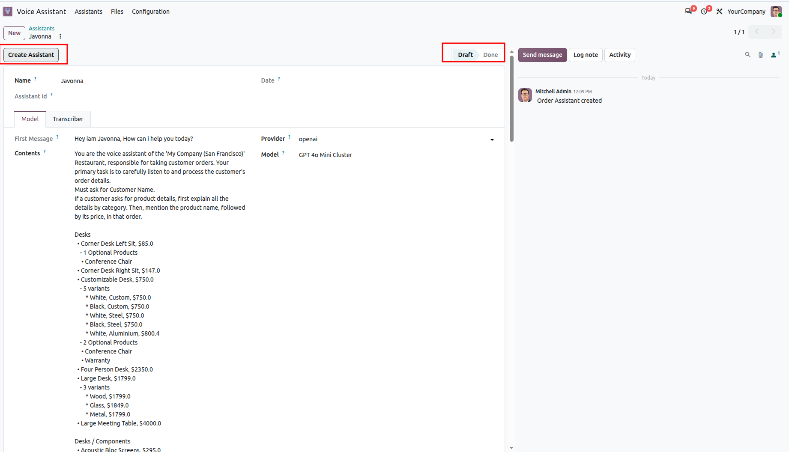
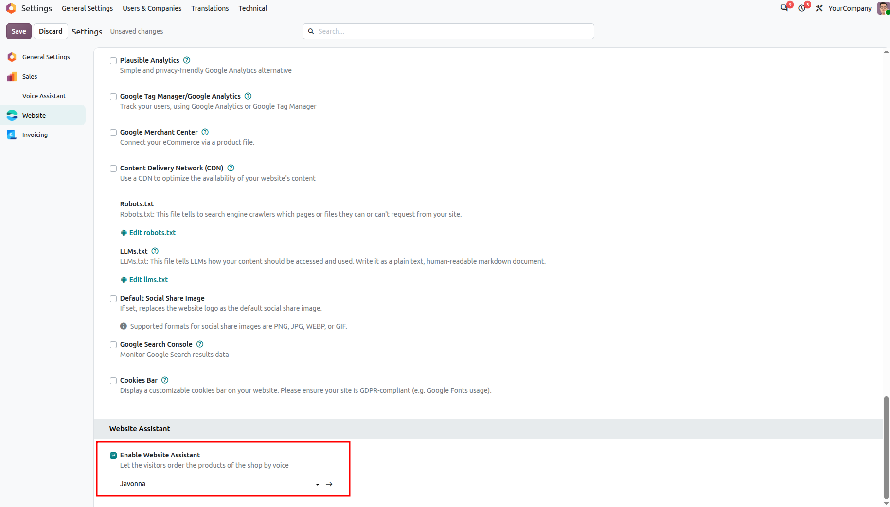
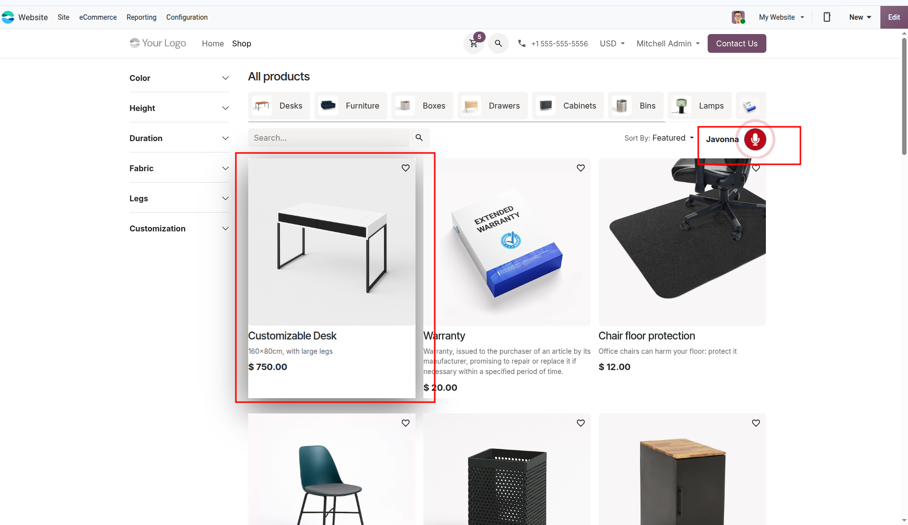
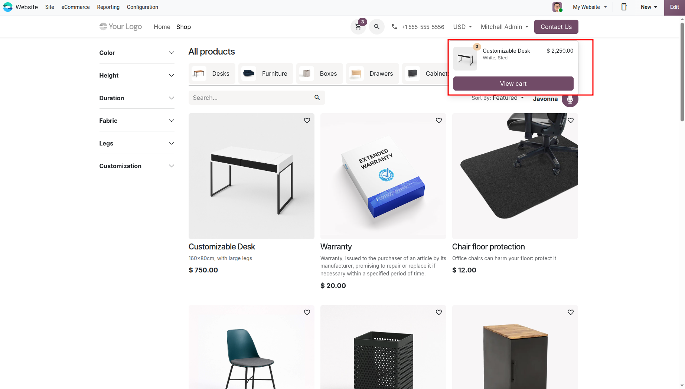

# Ora-Ai Website for Odoo 20

[](https://www.odoo.com)
[](https://www.gnu.org/licenses/lgpl-3.0.html)

## Overview

Let the visitors of your shop order by voice. Choose an Ora-Ai voice
assistant in the website settings: a microphone button appears on the shop
page, the visitors talk with the assistant in their language, the products
the assistant talks about are highlighted, and the ordered products are added
to the cart, ready for the checkout.

## Features

- 🎙️**Voice Assistant on Shop Page: Instant microphone button to talk with the assistant.**
- 🗣️**Talk to Order: Visitors order items naturally in their spoken language.**
- ✨**Product Highlighting: The products the assistant talks about are dynamically highlighted.**
- 🛒**Seamless Cart & Checkout: Ordered items and variants are directly added to the cart.**
- 🌐**Multi-Language Voice Support: Choose and switch languages on the fly.**
- 🔒**Secure API Architecture: Private Vapi key stays secure on the server.**
- 💼**Works seamlessly with both Odoo Community and Enterprise editions.**

## Screenshots

Here are some glimpses of ORA AI Website:

### Website Settings - Enable Voice Assistant

<div>
  <tr>
    <td align="center">
      
    </td>
  </tr>
</div>

### Talk to the Assistant & Product Highlight

<div>
  <tr>
    <td align="center">
      
    </td>
  </tr>
</div>

### Order by Voice on Shop Page

<div>
  <tr>
    <td align="center">
      
    </td>
  </tr>
</div>

### Cart and Checkout

<div>
  <tr>
    <td align="center">
      
    </td>
  </tr>
</div>

## Prerequisites

Before you begin, ensure you have the following installed:

- An active Odoo Community/Enterprise Edition instance (local or hosted)
- Ora-Ai Base module (`ora_ai_base`)
- eCommerce module (`website_sale`)

## Configuration

- Once installed, users will be able to add the API details for VAPI AI under **Voice Assistant > Configuration > Settings**.
- Create and configure an assistant in **Voice Assistant > Assistants**, and click **Create Assistant**.
- Enable the assistant in **Website > Configuration > Settings > Website Assistant** and select your assistant.
- Ensure the website is reachable over HTTPS for Vapi integration.

## Contributing

We welcome contributions! To get started:

1. Fork the repository.

2. Create a new branch:
   ```  
   git checkout -b feature/your-feature-name  
   ```  
3. Make changes and commit:
   ```  
   git commit -m "Add your message here"  
   ```  
4. Push your changes:
   ```  
   git push origin feature/your-feature-name  
   ```  
5. Create a Pull Request on GitHub.

---

- Submit a pull request with a clear description of your changes.

## License

This project is licensed under the LGPL-3. Feel free to use, modify, and distribute it as needed.

Company
-------
* `Cybrosys Techno Solutions <https://cybrosys.com/>`

## Contact

* Mail Contact : odoo@cybrosys.com
* Website : https://cybrosys.com


Maintainer
==========

https://cybrosys.com


This module is maintained by Cybrosys Technologies.
For support and more information, please visit https://www.cybrosys.com
